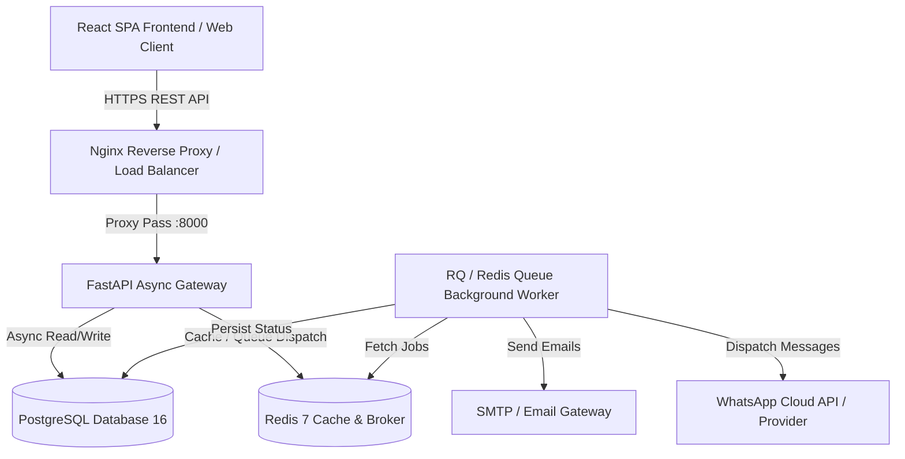
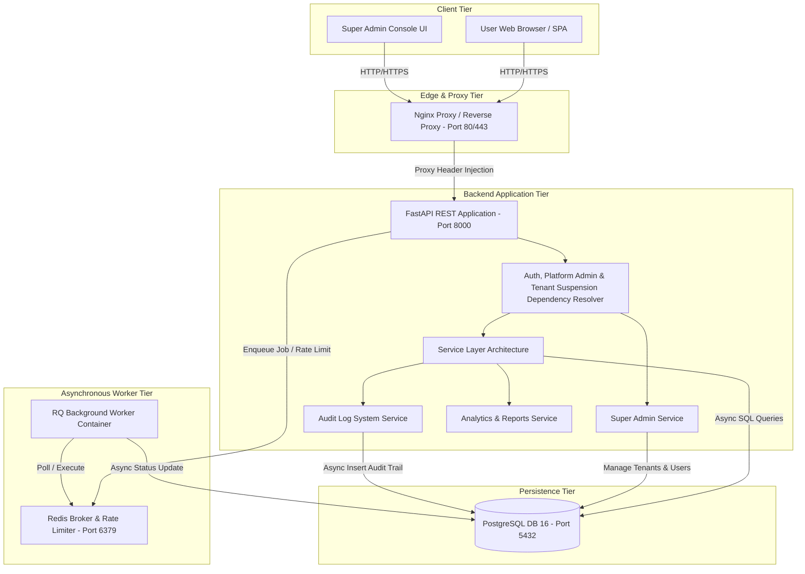

# BizSathi - Complete Technical & Functional Project Documentation

> **Document Type:** Production Launch Technical Documentation & Architecture Manual  
> **Target Audience:** CTO, Technical Lead, System Administrators, Senior Developers  
> **Project Name:** BizSathi - Multi-Tenant MSME Enterprise Resource & Business Management Platform  
> **Version:** 1.1.0 (Production Release Candidate)  
> **Date:** October 2026  
> **Document Status:** Authoritative Source of Truth  

---

## Table of Contents
1. [Project Overview](#1-project-overview)
2. [Technology Stack](#2-technology-stack)
3. [System Architecture](#3-system-architecture)
4. [Database Documentation](#4-database-documentation)
5. [API Documentation](#5-api-documentation)
6. [Feature Documentation](#6-feature-documentation)
7. [Authentication & Authorization](#7-authentication--authorization)
8. [Backend Architecture](#8-backend-architecture)
9. [Frontend Architecture](#9-frontend-architecture)
10. [Third-Party Integrations](#10-third-party-integrations)
11. [Error Handling & Validation](#11-error-handling--validation)
12. [Security](#12-security)
13. [Environment Configuration](#13-environment-configuration)
14. [Deployment & Infrastructure](#14-deployment--infrastructure)
15. [Logging & Monitoring](#15-logging--monitoring)
16. [Database Migrations & Data Management](#16-database-migrations--data-management)
17. [Testing](#17-testing)
18. [Production Readiness](#18-production-readiness)
19. [Known Issues & Technical Debt](#19-known-issues--technical-debt)
20. [Future Improvements](#20-future-improvements)
21. [Glossary](#21-glossary)
22. [Production Launch Summary](#22-production-launch-summary)

---

## 1. Project Overview

### Purpose of the Project
**BizSathi** is an all-in-one, multi-tenant Software-as-a-Service (SaaS) platform designed specifically for Micro, Small, and Medium Enterprises (MSMEs) in India and emerging markets. It bridges the gap between complex enterprise ERPs and fragmented single-purpose tools by delivering a unified, real-time operating system for business operations.

BizSathi integrates Customer Relationship Management (CRM), Sales & Invoicing, Inventory & Stock Management, Vendor Management, Human Resource Management (HRM) & Payroll, Office Expense Management, Marketing Automation (WhatsApp & Email Campaigns), Super Admin Platform Governance & Dual Onboarding, Cross-Domain Business Analytics & Reports, Security Audit Logging, and Multi-Tenant Administration into a high-performance web platform.

### Main Goals and Use Cases
* **Centralized Business Management:** Single-pane dashboard for owners, super admins, and department managers to track revenue, customer debt, active sales pipelines, inventory stock levels, workforce attendance, expense outflows, and platform metrics.
* **Super Admin Platform Governance & Dual Tenant Onboarding:** Platform admin console supporting self-service public business signup with rate limiting, super-admin provisioned business accounts with single-use invitation tokens, cross-tenant audit logging, platform metrics, and instant business suspension/reactivation.
* **Shared Resolution Tenant Suspension:** Instant security blocking at the shared tenant-resolution layer (`get_current_tenant`), halting access across all module endpoints when a business is suspended.
* **Strict Multi-Tenant Isolation:** Complete logical isolation of data per organization (tenant) using row-level tenant identification (`tenant_id`), preventing cross-tenant leaks.
* **Automated Sales-to-Cash Workflow:** Seamless conversion of Leads to Customers, Quotations to Invoices, with automatic credit limit validation, payment receipt generation, and customer outstanding balance ledgers.
* **Real-Time Inventory Control & Stock Ledger:** Track products, SKU categories, unit definitions, reorder threshold alerts, physical count adjustments with variance tracking, stock valuation, bulk CSV imports, vendor supplier links, and automated stock deduction/reversal on sales invoices.
* **Vendor Directory & Supplier Control:** Manage suppliers, track payables opening balances, record contact/GSTIN details, CSV import, and link stock receipts to vendor profiles.
* **HRM & Payroll Compliance:** Attendance check-in/out calculation, leave request workflows with balance tracking, salary advance deductions, and automated monthly payroll runs generating downloadable HTML/PDF payslips.
* **Comprehensive Analytics & Reports:** Executive, Financial (P&L, Cash Flow), Sales, CRM, HRM, Inventory, Expense, and Vendor analytics with itemized data tables and multi-format export capabilities.
* **Targeted Marketing Campaigns:** Audience segmentation by city or customer type, WhatsApp template approval workflows, and multi-channel campaign dispatch (WhatsApp/Email).
* **Enterprise Auditability:** Immutable, event-driven audit logging for all critical operations (login, data modification, stage movement, payment recording, tenant suspension, settings changes).

### High-Level Architecture
BizSathi follows a modern **Decoupled Single-Page Application (SPA) + Asynchronous API Gateway + Background Task Queue** architecture:



---

## 2. Technology Stack

### Frontend Technologies
| Component | Technology | Version | Purpose |
|---|---|---|---|
| Core Library | React | 19.1.0 | UI rendering and component tree |
| Build Tool | Vite | 7.1.2 | Development server & fast production bundler |
| Type System | TypeScript | 5.9.2 | Strict static typing and compile-time checks |
| Router | React Router DOM | 7.18.4 | Client-side SPA routing & route protection |
| State & Query | TanStack React Query | 5.103.1 | Server state caching, background refetching |
| HTTP Client | Axios | 1.7.2 | Interceptor-based API request layer |
| Form Handling | React Hook Form | 7.15.0 | Dynamic form handling with zero re-renders |
| Form Validation | Zod | 3.23.8 | Schema declaration & runtime validation |
| Styling | TailwindCSS | 3.4.15 | Utility-first CSS layout engine |
| Component Helpers | clsx | 2.1.1 | Conditional class construction |
| Icon Library | Lucide React | 0.542.0 | Consistent vector UI iconography |
| Testing Engine | Vitest + RTL | 3.2.4 | Unit & component integration testing |

### Backend Technologies
| Component | Technology | Version | Purpose |
|---|---|---|---|
| Language | Python | 3.12+ | High-performance backend runtime |
| Web Framework | FastAPI | 0.115.6 | Asynchronous ASGI REST API framework |
| Server | Uvicorn | 0.32.1 | ASGI HTTP server implementation |
| ORM | SQLAlchemy | 2.0.36 | Async Object-Relational Mapping (Declarative) |
| Async DB Driver | AsyncPG | 0.30.0 | High-performance PostgreSQL async driver |
| Migrations | Alembic | 1.14.0 | Schema migration and version management |
| Data Validation | Pydantic v2 | 2.10.6 | Request/Response parsing and schema serialization |
| Auth & Crypto | Python-Jose / Passlib | 3.3.0 / 1.7.4 | JWT token management & Bcrypt hashing |
| Static Checking | Mypy & Ruff | 1.15 / 0.8 | Type safety and linting compliance |
| Unit Testing | Pytest & Pytest-Asyncio | 8.3.4 / 0.25 | Asynchronous unit and API integration testing (265 tests) |

### Database & Caching
* **Primary Relational Store:** PostgreSQL 16 (Alpine Container) with strict UUID primary keys and tenant-scoped indexes.
* **In-Memory Broker & Cache:** Redis 7 (Alpine Container) serving task queues (`rq`), session tracking, rate limiting (5 req/hr on signup), and readiness health checks.

### Authentication & Authorization
* **Token Standard:** JSON Web Tokens (JWT) signed using `HS256`.
* **Platform Authorization:** `is_platform_admin` flag on `User` evaluated via `get_current_platform_admin` dependency.
* **Tenant Access & Suspension:** `get_current_tenant` dependency validates tenant active membership and checks `Tenant.status`. If `"Suspended"`, rejects request with `403 Forbidden` across all endpoints.
* **Password Hashing:** `passlib[bcrypt]` with dynamic automatic salting.
* **Access Control:** Role-Based Access Control (RBAC) via FastAPI `require_permission` dependencies.

---

## 3. System Architecture

### Overall System Architecture Diagram



---

## 4. Database Documentation

The database schema comprises **46 tables** categorized into 9 core functional domains:
1. **Domain, Auth & Billing (13 tables):** `tenants`, `users`, `roles`, `permissions`, `tenant_members`, `user_roles`, `invitations`, `sessions`, `refresh_tokens`, `audit_logs`, `plans`, `subscriptions`, `usage_records`.
2. **Super Admin Domain (Platform Governance):** Extensions to `users` (`is_platform_admin`) and `tenants` (`status`, `created_via`, `suspended_at`, `suspended_reason`).
3. **CRM Domain (5 tables):** `leads`, `pipeline_stages`, `deals`, `activities`, `customers`.
4. **Sales & Billing Domain (6 tables):** `sales_sequences`, `quotations`, `quotation_items`, `invoices`, `invoice_items`, `payments`.
5. **Inventory & Stock Management Domain (4 tables):** `product_categories`, `units`, `products`, `stock_movements`.
6. **HRM & Payroll Domain (12 tables):** `departments`, `designations`, `work_schedules`, `holidays`, `employees`, `salary_structures`, `attendances`, `leave_types`, `leave_requests`, `salary_advances`, `payrolls`, `payslips`.
7. **Marketing Domain (3 tables):** `templates`, `campaigns`, `campaign_recipients`.
8. **Office Expense Domain (2 tables):** `expense_categories`, `expenses`.
9. **Vendor Management Domain (1 table):** `vendors`.

---

### Key Schema Extensions (Super Admin & Platform Governance)

#### 1. `tenants` Schema Updates
* **`status`**: `VARCHAR(50)`, Default: `"Active"` (Values: `"Active"`, `"Suspended"`).
* **`created_via`**: `VARCHAR(50)`, Default: `"SELF_SIGNUP"` (Values: `"SELF_SIGNUP"`, `"SUPER_ADMIN"`).
* **`suspended_at`**: `TIMESTAMPTZ`, Nullable.
* **`suspended_reason`**: `TEXT`, Nullable.

#### 2. `users` Schema Updates
* **`is_platform_admin`**: `BOOLEAN`, Default: `false`, Non-Nullable. Identifies super-admin users with cross-tenant platform management rights.

---

## 5. API Documentation

All API endpoints are mounted under the root `/api/v1` prefix and enforce JSON request/response formats.

### Platform Super Admin Endpoints (`/api/v1/admin`)
| Method | Endpoint | Auth / Permission | Description |
|---|---|---|---|
| `GET` | `/admin/dashboard` | Platform Admin | Platform-wide metrics (total, active, suspended, new, setup pending counts). |
| `GET` | `/admin/businesses` | Platform Admin | Paginated, searchable, status-filterable business tenant directory listing. |
| `POST` | `/admin/businesses` | Platform Admin | Provisions new business workspace with owner profile and generates 7-day single-use setup invite token. |
| `GET` | `/admin/businesses/{id}` | Platform Admin | Detailed business tenant overview, member count, and owner profile. |
| `PUT` | `/admin/businesses/{id}/suspend` | Platform Admin | Suspends business tenant with audit log reason; immediately blocks tenant API access. |
| `PUT` | `/admin/businesses/{id}/reactivate` | Platform Admin | Reactivates suspended business tenant; restores API access with data intact. |
| `GET` | `/admin/audit-logs` | Platform Admin | Cross-tenant global platform audit log search and viewer. |
| `GET` | `/admin/settings` | Platform Admin | Retrieves global platform configuration settings. |
| `PUT` | `/admin/settings` | Platform Admin | Updates global platform configuration settings. |

---

### Public Onboarding & Auth Endpoints (`/api/v1/auth`)
| Method | Endpoint | Auth Required | Description / Summary |
|---|---|---|---|
| `POST` | `/auth/register-business` | None (Rate Limited) | Self-service public signup (max 5/hr per IP). Creates tenant + owner and returns login tokens. |
| `POST` | `/auth/complete-setup` | None | Consumes single-use setup invite token generated by Super Admin to set password and complete setup. |
| `POST` | `/auth/register` | None | Legacy user registration endpoint. |
| `POST` | `/auth/login` | None | Authenticates email & password, writes login audit log, returns JWT access & refresh tokens. |
| `POST` | `/auth/refresh` | None | Validates refresh token payload and returns new access/refresh token pair. |
| `GET` | `/auth/me` | Bearer Token | Returns current authenticated user profile, platform admin status, tenant ID, roles, permissions. |
| `POST` | `/auth/logout` | Bearer Token | Logs out user and records logout audit log. |

---

### Reports & Analytics Endpoints (`/api/v1/reports`)
| Method | Endpoint | Permission Required | Description |
|---|---|---|---|
| `GET` | `/reports/dashboard` | None (Tenant Auth) | Executive dashboard summary (revenue, debt, expenses, low stock, payroll totals). |
| `GET` | `/reports/financial` | None (Tenant Auth) | Financial P&L summary, income vs expense breakdowns, cash flow statement metrics. |
| `GET` | `/reports/sales` | None (Tenant Auth) | Sales performance by month, product, and customer. |
| `GET` | `/reports/crm` | None (Tenant Auth) | Lead conversion rates, pipeline stage distribution, win/loss ratios. |
| `GET` | `/reports/hrm` | None (Tenant Auth) | Attendance percentage, leave utilization, monthly payroll cost trends. |
| `GET` | `/reports/inventory` | None (Tenant Auth) | Stock valuation, reorder alert items, fast/slow-moving inventory items. |
| `GET` | `/reports/expenses` | None (Tenant Auth) | Category-wise expense breakdown and vendor payment summaries. |
| `GET` | `/reports/export` | None (Tenant Auth) | Exports generated report data to CSV/JSON format. |

---

## 6. Feature Documentation

### Major Feature Summary Table
| Feature Name | Business Purpose | Key Tables Involved | Key APIs Involved | Key Business Rules |
|---|---|---|---|---|
| **Super Admin Console** | Platform administration & tenant governance | `tenants`, `users`, `audit_logs` | `/api/v1/admin/*` | Restricts access to `is_platform_admin = True`; audit-logs all platform actions |
| **Dual Tenant Onboarding** | Supports self-service & provisioned accounts | `tenants`, `users`, `sessions` | `POST /auth/register-business`, `POST /auth/complete-setup` | Enforces 5 req/hr rate limit on self-signup; single-use token enforcement on setup completion |
| **Tenant Suspension Control** | Immediate security blocking | `tenants` | `PUT /admin/businesses/{id}/suspend` | Shared `get_current_tenant` dependency immediately blocks suspended tenants across ALL endpoints (HTTP 403) |
| **CRM Pipeline** | Drives sales opportunity conversion | `leads`, `deals`, `pipeline_stages`, `activities`, `customers` | `POST /crm/leads`, `PUT /crm/deals/{id}` | Moving Deal to "Won" automatically converts Lead to Customer idempotently |
| **Sales Invoicing & Payment** | Manages quotes, invoices & cash collection | `quotations`, `invoices`, `payments`, `sales_sequences` | `POST /sales/invoices`, `POST /sales/payments` | Validates customer credit limit; updates invoice balance and customer statement ledger |
| **Inventory & Stock Control** | Manages stock catalog, reorder alerts & ledger audit | `products`, `product_categories`, `units`, `stock_movements` | `POST /inventory/stock/in`, `POST /inventory/stock/out` | Prohibits negative stock; auto-deducts on sales invoices and restores stock on cancellation |
| **Vendor Management** | Supplier directory & purchase links | `vendors`, `stock_movements` | `POST /vendors`, `POST /vendors/import` | Soft delete only (preserves historic stock movement links); deduplicates on phone during CSV import |
| **HRM Attendance & Payroll** | Workforce management & monthly payroll | `employees`, `attendances`, `leave_requests`, `payrolls`, `payslips` | `POST /hrm/attendance/check-in`, `POST /hrm/payroll/run` | Calculates unpaid absence deductions and recovers salary advances during monthly run |
| **Reports & Analytics** | Executive & department insights | All business tables | `/api/v1/reports/*` | Aggregates multi-module business metrics with real-time multi-tenant scoping |

---

## 7. Authentication & Authorization

### Authentication Architecture
* **Platform Admin Authorization:** `get_current_platform_admin` evaluates `user.is_platform_admin`. Non-admin users (including regular tenant owners) are rejected with `HTTP 403 Forbidden`.
* **Tenant Resolution & Suspension Check:** `get_current_tenant` extracts `X-Tenant-ID` header, verifies tenant membership, and checks `Tenant.status`. If `"Suspended"`, immediately halts execution with `HTTP 403 Forbidden` (`"Business account is suspended"`).
* **Rate Limiting:** Public self-signup (`POST /api/v1/auth/register-business`) is rate-limited to 5 requests per hour per IP using Redis / in-memory sliding window limiter (`app/core/rate_limit.py`). Returns `HTTP 429` on 6th attempt.

---

## 8. Backend Architecture

### Module Structure (`backend/app/`)
```
backend/app/
├── api/
│   ├── deps.py             # Auth, Platform Admin & Tenant Suspension dependencies
│   └── v1/                 # Version 1 REST controllers (admin, auth, crm, sales, inventory, hrm, expenses, vendors, marketing, reports)
├── core/
│   ├── config.py           # Pydantic Settings & environment loader
│   ├── database.py         # SQLAlchemy async engine & session maker
│   ├── rate_limit.py       # Sliding-window Redis/memory rate limiter
│   ├── redis.py            # Redis client connection manager
│   └── security.py         # Bcrypt hashing & JWT token encode/decode
├── models/                 # SQLAlchemy 2.0 ORM Declarative Models (47 tables)
├── repositories/           # Database access layer abstraction
├── schemas/                # Pydantic v2 validation DTO schemas
├── services/               # Core business logic, tenant services, PDF generators, background jobs
└── main.py                 # FastAPI application entrypoint & exception handlers
```

---

## 9. Frontend Architecture

### Application Structure (`frontend/src/`)
```
frontend/src/
├── app/
│   ├── providers/          # QueryClientProvider, AuthProvider, TenantProvider
│   └── router/index.tsx    # React Router DOM configuration with AuthGuard & AdminGuard
├── features/
│   ├── admin/              # AdminGuard, AdminLayout, Dashboard, Businesses, Audit Logs, Settings
│   ├── auth/               # RegisterBusinessPage, CompleteSetupPage, LoginPage
│   ├── crm/                # Leads, Deals, Activities, Customers
│   ├── sales/              # Quotations, Invoices, Payments
│   ├── inventory/          # Products, Categories, Units, Stock Movements
│   ├── hrm/                # Employees, Attendance, Leave, Payroll
│   ├── expenses/           # Categories, Expenses, Receipt Upload
│   ├── vendors/            # Supplier directory, CSV import
│   ├── marketing/          # Templates, Campaigns
│   └── reports/            # Executive & Department Analytics Dashboards
├── layouts/                # DashboardLayout, AdminLayout, AuthLayout
└── services/               # Axios instance (`apiClient.ts`) with request interceptors
```

---

## 16. Database Migrations & Data Management

* **Tool:** Alembic (Version controlled in `backend/migrations/versions/`).
* **Applied Migration History:**
  1. `001_initial_schema.py`: Core domain, auth, CRM, sales, HRM tables.
  2. `002_crm_hardening_indexes.py`: CRM composite indexes & lead conversion fields.
  3. `003_sales_module.py`: Sales sequences, quotations, invoices, payments.
  4. `004_hrm_module.py`: HRM setup, employees, attendance, leave, advances, payroll.
  5. `005_hrm_addendum.py`: Additional employee profile attributes.
  6. `006_add_customer_fields.py`: Customer credit limits, PAN, GSTIN fields.
  7. `007_whatsapp_email_campaigns.py`: Marketing templates and campaign tracking.
  8. `008_expense_module.py`: Expense categories and office expenses.
  9. `009_audit_log_fields.py`: Additional audit logging fields.
  10. `010_inventory_module.py`: Product categories, units, catalog, stock movements.
  11. `011_vendor_module.py`: Vendor management table (`vendors`) with opening balances and `vendor_id` foreign key on `stock_movements`.
  12. `012_superadmin_phase1.py`: Added `is_platform_admin` to `User` and `status`, `created_via`, `suspended_at`, `suspended_reason` to `Tenant`. Verified clean against fresh database.

---

## 17. Testing

### Verification & Test Suite Matrix
| Test Suite | Tool / Command | Coverage / Scope | Result Status |
|---|---|---|---|
| **Backend Test Suite** | `pytest` | Auth, Super Admin, CRM, Sales, Inventory, Vendors, HRM, Expenses, Audit, Reports, Permissions | **298 / 298 Passed (100%)** |
| **Super Admin Itemized Suite** | `pytest tests/test_superadmin.py -v` | Itemized coverage for admin guards, dual signup, rate limiting, setup token single-use, suspension & reactivation | **12 / 12 Passed (100%)** |
| **Backend Type Safety** | `mypy app` | Mypy static type checking across 96 Python source files | **Pass (0 Errors)** |
| **Backend Linting** | `ruff check .` | Ruff linting & code style check across backend codebase | **Pass (0 Errors)** |
| **Frontend Type Safety** | `npx tsc -b` | TypeScript build mode type check across frontend codebase | **Pass (0 Errors)** |
| **Frontend Linting** | `npm run lint` | ESLint static analysis across frontend codebase | **Pass (0 Errors, 0 Warnings)** |
| **Frontend Production Build** | `npx vite build` | Vite asset bundling & minification (1,897 modules transformed) | **Pass (Clean Dist Built)** |

---

## 22. Production Launch Summary

### Executive Launch Summary
* **Current Architecture:** Decoupled React 19 SPA + FastAPI Async Microservices + PostgreSQL 16 + Redis 7 Broker + RQ Worker Queue.
* **Completed Core Modules:** Super Admin Console & Platform Governance, Dual Tenant Onboarding (Self-Service Signup & Provisioned Accounts), Shared Resolution Tenant Suspension Enforcement, Multi-Tenant Authentication & RBAC, CRM Pipeline, Sales & Invoicing with Outstanding Ledgers, Customer & Vendor Directory Management, Inventory & Stock Control, HRM Workforce & Payroll Runs, Office Expense Tracking, Marketing Campaign Automation, Comprehensive Analytics & Reports, and Enterprise Security Audit Logging.
* **Quality Assurance Verification:** 100% backend Pytest suite pass (**298 passed tests**), 100% Super Admin itemized test pass (12/12), 100% Ruff compliance, clean fresh database migration test (`alembic upgrade head`), verified rate-limiting and suspension blocking on live server, clean Vite production build.
* **Production Dependencies:** Docker Engine 24+, PostgreSQL 16, Redis 7, Nginx 1.24+.
* **Recommended Launch Next Steps:** Configure production `JWT_SECRET_KEY` and `DATABASE_URL` secrets in `.env`, run `alembic upgrade head`, set `VITE_SHOW_DEV_LOGIN_HINT=false`, and execute final SSL certificate binding via Nginx.
